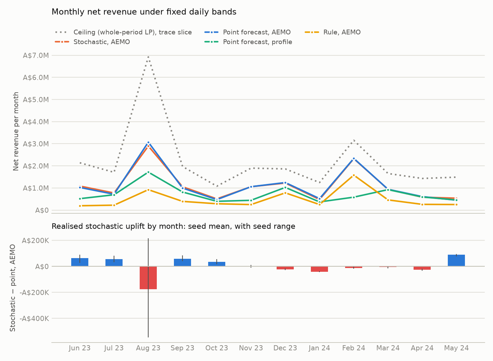
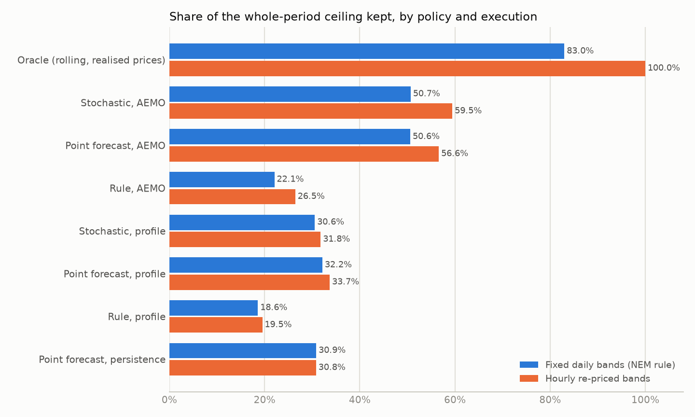
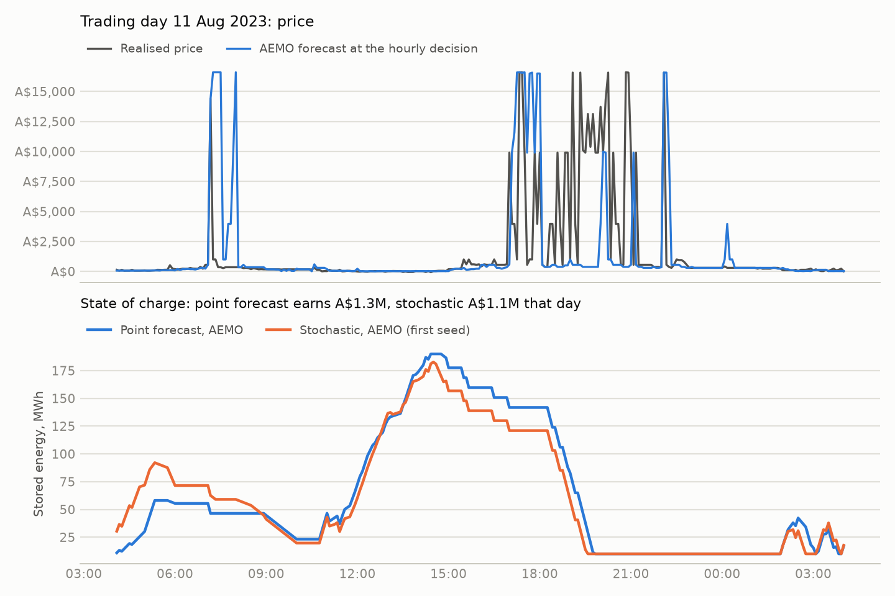

# How much battery arbitrage survives imperfect forecasts?

*A holdout study of a hypothetical 100 MW / 200 MWh battery in South Australia,
June 2023 to May 2024.*

## Question and answer

The study asks two questions. How much of the perfect-foresight
energy-arbitrage value survives imperfect forecasts? And when does modelling
forecast uncertainty improve the realised dispatch?

The answers come from twelve untouched months under the NEM's own bidding
rule, with band prices fixed the day before.

- **Value kept.** A point-forecast optimiser on AEMO's published forecasts
  keeps **50.6%** of the whole-year ceiling. An oracle running the same engine
  on realised prices keeps 83.0% under the same rule.
- **Value of AEMO's forecasts.** They are worth A$4.9M a year over a naive
  7-day profile.
- **Value of the optimiser.** It is worth A$7.6M a year over a simple
  cheapest/dearest-hours rule on the same forecast.
- **Uncertainty modelling.** It **did not measurably help** under the NEM
  rule. The stochastic policy around AEMO's forecasts and the point-forecast
  policy are level: A$13.47M against A$13.45M. The predeclared verdict is
  *inconclusive*, at +A$59 per trading day with a 95% interval of −A$2,466 to
  +A$2,091. Five scenario seeds move the difference by ±A$450k, more than the
  difference itself.
- **Where it gains and loses.** The stochastic policy earns A$309k more in
  ordinary intervals and gives A$287k back in the year's 120 highest-priced
  intervals. Without those intervals it *wins*, at +A$876 per day (interval
  +A$311 to +A$1,468).
- **Around the naive profile** it *loses*, by −A$1,158 per day.
- **Hourly re-pricing.** Where bands can be re-priced every hour, which the
  NEM does not allow, the stochastic AEMO policy is ahead by A$757k (5.0%).
  That is still inconclusive overall, but a win once the 24 highest-priced
  intervals are removed.

Uncertainty modelling therefore helps where the forecast is good and prices
behave, and its edge is lost in the spikes and to the coarseness of
day-ahead band prices.

## Data

- **Prices.** AEMO five-minute dispatch prices for SA1, intervention-free and
  interval-ending, via NEMOSIS.
- **AEMO forecasts.** Every pre-dispatch and P5MIN run from the MMSDM archive,
  each stamped with when it was published.
- **Loss factors.** Hornsdale 275 kV (HPRG1/HPRL1), from AEMO's MLF reports
  for FY2022-23 and FY2023-24.
- **Checks.** Each input month's checksum is in the run manifest, and
  `scripts/verify_inputs.py` re-verified all fourteen months the test read.
- **Coverage.** It was checked before any policy ran
  ([`data/coverage/`](../data/coverage/)): every month of the test and
  validation periods is complete, and no month was excluded.

## Timing and information

- **Decisions.** Every hour the policy plans 24 hours ahead from what it knew
  at that moment: settled prices, and the AEMO runs published by then.
- **Bidding rule.** The headline execution follows the NEM. For each trading
  day (04:00–04:00 AEST), ten band prices per direction are fixed at 12:30
  the day before, and each hour may only move quantity between them. Seven
  bands are quantiles of the limit prices the day-ahead plan wants. Three are
  a ladder towards the price cap or floor.
- **Hourly re-pricing.** This comparison re-prices the ten bands every hour.
  It is a labelled idealisation, and the gap between the two measures what
  the NEM rule costs.
- **Clearing.** Offers clear against the historical regional price. The
  battery is a price taker; there is no dispatch engine, network constraint
  or market impact.
- **Latency.** Decisions see prices up to the moment of decision. A
  15-minute latency sensitivity is reported below.

## Models

| Policy | Forecast | Plan |
|---|---|---|
| Ceiling | realised | whole year as one LP, exclusivity relaxed: an upper bound under the model, not an attainable policy |
| Oracle | realised | the rolling engine: an oracle benchmark, not a proven optimum at its cadence |
| Rule | AEMO or profile | charge in the 2 cheapest and discharge in the 2 dearest forecast hours of the next 24, if that clears losses and degradation |
| Point forecast (L2) | AEMO, profile or persistence | hourly MILP on the point forecast |
| Stochastic (L3) | AEMO or profile | hourly two-stage MILP over 10 scenarios: the forecast plus the forecaster's own realised errors on 10 of the last 21 days, capped at 5%/95% |

All policies start empty, value closing inventory at zero, pay A$25 per
discharged MWh for degradation, and are settled by one function and audited
by the same gates. Every decision solved to optimality; the largest MIP gap
in the test was 7×10⁻⁷.

## Protocol

[PROTOCOL.md](PROTOCOL.md) was committed before any validation run and frozen
before the test.

| Stage | Period | Use |
|---|---|---|
| Development | Nov 2022, Apr 2023 | every design choice |
| Validation | Dec 2022 – Feb 2023 | one-at-a-time sensitivities and a mechanical selection rule |
| Test | Jun 2023 – May 2024 | run once, from a clean tree at the commit containing the frozen protocol |

- **Window.** The test sits wholly before the June 2024 bidirectional-unit
  change, and before the archive format changed.
- **Selection.** The validation rule adopted nothing, so the development
  defaults were tested.
- **Statistic.** The primary comparison is the paired daily difference by
  trading day, with a 7-day circular block bootstrap (10,000 draws). The
  verdict is a win, loss or inconclusive by its 95% interval.

## Results





| Test year, fixed daily bands | Net revenue | Share of ceiling | EFC |
|---|---:|---:|---:|
| Ceiling | A$26,563,506 | 100% | 750 |
| Oracle | A$22,044,758 | 83.0% | 488 |
| Stochastic, AEMO (5-seed mean) | A$13,467,100 | 50.7% | 524 |
| Point forecast, AEMO | A$13,445,499 | 50.6% | 501 |
| Point forecast, profile | A$8,542,165 | 32.2% | 447 |
| Point forecast, persistence | A$8,198,029 | 30.9% | 479 |
| Stochastic, profile | A$8,117,276 | 30.6% | 466 |
| Rule, AEMO | A$5,861,715 | 22.1% | 77 |
| Rule, profile | A$4,941,713 | 18.6% | 88 |

The ceiling's EFC belongs to its relaxed schedule. All tables are in
[`results/test/tables.md`](../results/test/tables.md), regenerated by
`scripts/make_report.py`.

Paired by trading day under fixed bands (367 trading days, including the
partial first and last):

| Comparison | Mean per day | 95% interval | Year total | Verdict |
|---|---:|---:|---:|---|
| **Stochastic − point, AEMO (primary)** | **+A$59** | **−A$2,466 to +A$2,091** | **+A$21,601** | **inconclusive** |
| same, without the 24 highest-price intervals | +A$131 | −A$2,246 to +A$2,091 | +A$48,226 | inconclusive |
| same, without the 120 highest-price intervals | +A$876 | +A$311 to +A$1,468 | +A$321,545 | win |
| Stochastic − point, profile | −A$1,158 | −A$1,815 to −A$376 | −A$424,889 | loss |
| AEMO − profile, point forecasts | +A$13,361 | +A$3,715 to +A$25,376 | +A$4,903,334 | win |
| Point forecast − rule, AEMO | +A$20,664 | +A$13,668 to +A$29,887 | +A$7,583,784 | win |

The stochastic AEMO policy's seed-by-seed difference ranged from −A$409,908
to +A$453,561. The interval above reflects day-to-day variation in this
year's realised differences. It is not a confidence interval for future
revenue.

**What the NEM's fixed band prices cost.** Re-pricing bands every hour, which
the NEM does not allow, would have been worth:

| Policy | Fixed bands | Hourly re-pricing | Difference |
|---|---:|---:|---:|
| Oracle | 83.0% | 100.0% | +A$4.5M |
| Stochastic, AEMO | 50.7% | 59.5% | +A$2.3M |
| Point forecast, AEMO | 50.6% | 56.6% | +A$1.6M |
| Point forecast, profile | 32.2% | 33.7% | +A$0.4M |

Even the oracle loses 17% of the ceiling to fixed band prices. A perfect plan
wants to trade at its own limit price, which a band fixed the day before
rarely matches. The conservative rule rounds a tranche to the next band no
worse than wanted, so a trade at the limit is often missed.

**Latency.** With a 15-minute decision delay, `L2_aemo` falls to 47.5% and
`L3_aemo` to 47.7%, about A$0.8M each
([`results/test-latency15/`](../results/test-latency15/tables.md)). The
stochastic−point comparison stays inconclusive at +A$207 per day.

## Why the stochastic policy wins or loses

The stochastic plan values stored energy against ten futures rather than one.
It therefore trades more often: 524 equivalent full cycles against 501.

- **Ordinary intervals.** It earns A$309k more outside the year's 120
  highest-priced intervals.
- **The spikes.** It earns A$287k less in them. August 2023 holds a quarter
  of the year's ceiling, and there it is A$176k behind on the seed mean (seeds
  range from −A$547k to +A$216k).
- **The case day.** On 11 August 2023, the day of the largest difference
  (below), the stochastic policy (first seed shown) sold part of its charge in
  the mid-afternoon at modest prices. It reached the evening spikes with less
  stored. That is consistent with hedging against futures in which the evening
  was calm, but one day cannot establish the mechanism.



Three explanations the evidence does **not** support:

- **A thin error history.** Development first blamed November 2022's
  shortfall on AEMO's missing October archive. Thinning a well-covered
  month's error history the same way, on the same dates, did not lower
  revenue ([`results/development/`](../results/development/summary.md)).
- **Tuning.** No validation alternative, including a 42-day pool with 20
  scenarios, uncapped errors, longer or shorter horizons, or shared
  decisions, moved the stochastic policy by 1 point of the ceiling
  ([`results/validation/`](../results/validation/summary.md)).
- **Clairvoyant scenario tails alone.** See the extension below.

## Extension: does the two-stage model's future information matter?

Layer 3 shares only the committed hour across scenarios. After it, each
scenario plans as if it knew its own future. A scenario tree removes that
optimism.

- **How the tree is built.** The bootstrapped fan is bundled into a tree that
  branches 2–2–2 at 1, 4 and 12 hours.
- **Its labels.** Labels come from each scenario's observed history at the
  decision time, so decisions are shared exactly while scenarios cannot be
  told apart. Hand-worked tests pin this, and a mutation that lets the tree
  see one unobserved interval is caught.
- **The comparison.** The two models are compared on identical bundled paths,
  over the validation period and both development months, with three seeds
  ([`results/extension/`](../results/extension/summary.md)).

The results:

- **Planned value.** The two-stage model expects 1.9–3.9% more value than the
  tree in every window, policy and execution. That is its optimism. One plan
  shared across every scenario expects 16–34% less.
- **First-hour decisions.** From 356 identical states through validation, the
  tree's committed hour matches the two-stage model's in 72% of decisions with
  AEMO forecasts and 59% with the profile. The mean stored-energy value at the
  end of the hour moves by under A$1/MWh.
- **Realised revenue.** Differences are small and of mixed sign, 0.1–2% of
  revenue. Under fixed bands the tree beats the bundled two-stage model in
  the validation period, by A$21k for AEMO and A$16k for the profile, both
  wins. In development it wins once, loses nowhere significantly and is
  otherwise inconclusive.
- **Cost.** It solves in the same time, about 0.01 s a decision.

Removing the optimism costs nothing to compute and slightly improves realised
decisions under fixed bands. It does not change the headline: the two-stage
model's clairvoyance is a real but second-order distortion. The tree was not
part of the frozen policy. A claim for it would need a new untouched period.

## Limitations

The full list is in [RESULTS.md](RESULTS.md#limitations). The ones that bound
this conclusion:

- **One region, one asset, one year.** The verdict concerns these twelve
  months in SA1. Its interval does not generalise to other years.
- **Price taker.** A 100 MW battery in SA1 would move prices, especially in
  spikes, where both policies earn most.
- **Energy only.** No FCAS, contracts or caps; FCAS is 0% of *modelled*
  revenue.
- **Execution.** The fixed-band rules are one simple causal design. A trader
  with five-minute rebids and better band design would do better, perhaps
  differently for each policy.
- **Simple scenarios.** Scenarios are the forecaster's own past errors,
  conditioned only on time of day. A conditional error model could change the
  stochastic result.
- **Inventory.** Closing inventory is valued at zero, and degradation is a
  flat A$25/MWh.

## Reproduce

```powershell
uv sync --frozen --extra dev --extra report
uv run python scripts/check_coverage.py --first 2023-05 --last 2024-05
uv run python scripts/run_study.py config/studies/test.toml --jobs 7
uv run python scripts/make_report.py runs/test-651eeca4c3 --out results/test
uv run python scripts/verify_inputs.py results/test/report_manifest.json
```

The test takes 25 minutes on 7 worker processes. The validation, development
and extension suites are `scripts/run_experiments.py <suite>` followed by
`scripts/summarise_suite.py <suite>`. The GitHub workflow `study.yml` runs the
test on demand.
